# 🎓 Campus Event Explorer

**Name:** Ankita Patra  
**Course:** CS501 E1  
**Assignment:** Individual Coding Assignment 3 — Campus Event Explorer  
**Package:** `com.ankitapatra.campuseventexplorer`  
**Repository:** [CS501-E1-CampusEventExplorer](https://github.com/2003Ankita/CS501-E1-CampusEventExplorer)

---

## Overview

Campus Event Explorer is a colorful Android application built with Kotlin, Jetpack Compose, Material 3, and Navigation Compose. It helps students discover campus activities, search events, view details, and share event information.

## Features

- Eight sample campus events with unique, stable `Long` IDs.
- Scrollable event list using `LazyColumn` and stable item keys.
- Live search by event title or category.
- Search state preserved across configuration changes using `rememberSaveable`.
- Type-safe navigation between event list and detail screens.
- Detailed event information, including title, category, location, time, and description.
- Android Sharesheet integration using `Intent.ACTION_SEND`.
- Graceful handling of unknown event IDs.
- Reusable Compose components and a custom Material 3 theme.

## Screenshots

### 1. Event List — All Campus Events

**Test Case:** Launch application

**Expected Result:** Displays all 8 campus events in a scrollable list.

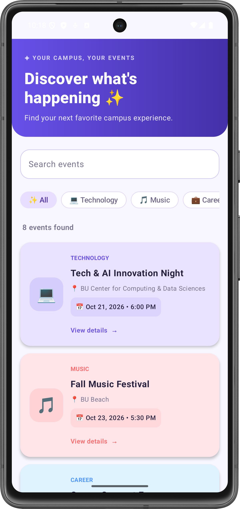

### 2. Search by Event Title

**Test Case:** Search by event title

**Input:** `Innovation`

**Expected Result:** Displays only Tech & AI Innovation Night.

**Observed Result:** 1 matching event displayed.

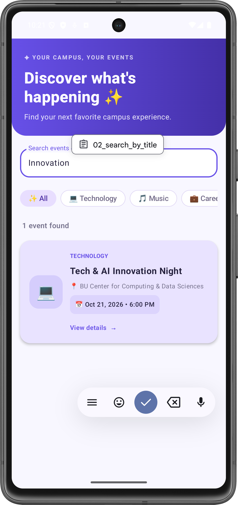

### 3. Search by Event Category

**Test Case:** Search by event category

**Input:** `Music`

**Expected Result:** Displays only events belonging to the Music category.

**Observed Result:** 1 event found — Fall Music Festival.

### 4. Filter Events Using Category Chips

**Test Case:** Filter events using category chips

**Action:** Select the Music category chip with an empty search field.

**Expected Result:** Only Music events appear, and the selected chip is highlighted.

**Observed Result:** Music chip highlighted, 1 event found — Fall Music Festival.

### 5. No Results Found

**Test Case:** Search with no matching events

**Input:** `xyz12345`

**Expected Result:** Displays zero events and a helpful empty-state message.

**Observed Result:** Entering `xyz12345` displayed 0 events and a helpful empty-state message. No event cards were shown.

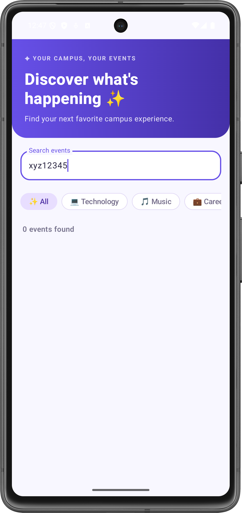

### 6. Event Details Navigation

**Test Case:** Navigate from event list to event details

**Action:** Tap Fall Music Festival.

**Expected Result:** Displays the correct event title, category,
date/time, location, and description.

**Observed Result:** Tapping Fall Music Festival successfully opened its details screen, displaying the correct title, category, date/time, location, and description.

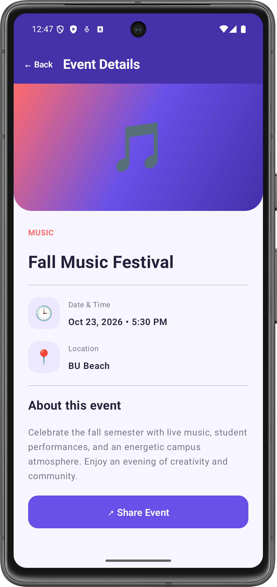

### 7. Share Event

**Test Case:** Share event using Android's share chooser

**Action:** Tap Share Event.

**Expected Result:** Opens the Android share chooser with event
title, time, and location.

**Observed Result:** Tapping Share Event successfully launched the Android share chooser with the event title, date/time, and location included in the shared text.

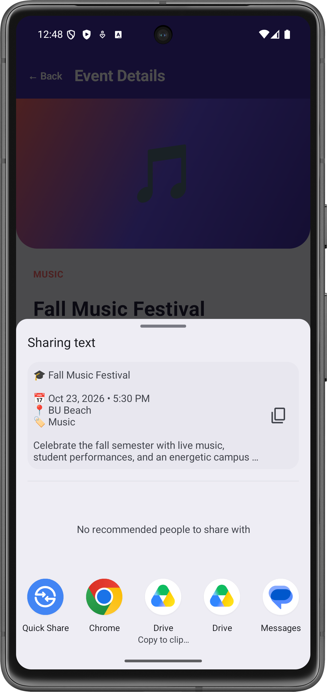

### 8. Search State After Rotation

**Test Case:** Preserve search state during device rotation

**Input:** `Music`

**Action:** Rotate emulator to landscape.

**Expected Result:** Search query and filtered results remain
unchanged after rotation.

**Observed Result:** After rotating the emulator to landscape, the search query `Music` remained populated, and the filtered event results were preserved.

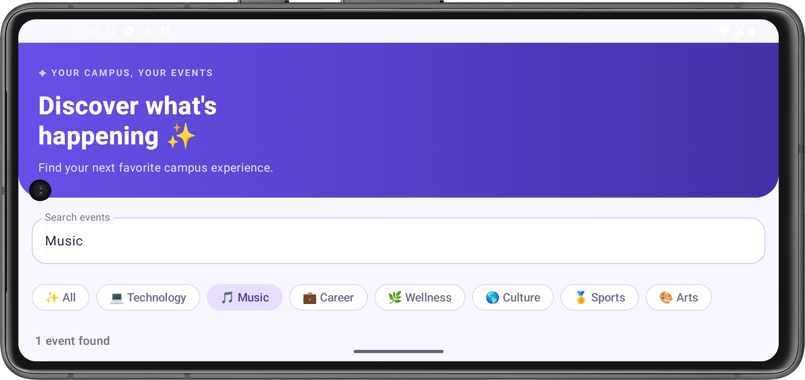

### 9. Back Navigation

**Test Case:** Return from details to event list

**Action:** Open Fall Music Festival, then tap Back.

**Expected Result:** Returns to the list with the previous search
query and filtered results preserved.

**Observed Result:** Tapping Back from the Event Details screen returned to the event list while preserving the previous search query and filtered results.

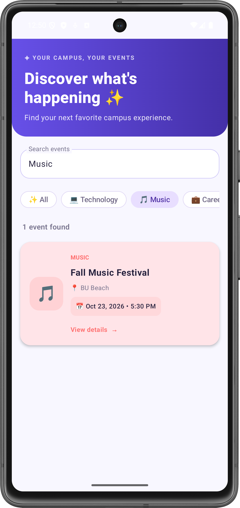

### 10. Case-Insensitive Search

**Test Case:** Search using mixed uppercase and lowercase letters.

**Input:** `mUsIc`

**Expected Result:** Search matches events regardless of capitalization.

**Observed Result:** Entering `mUsIc` displayed Fall Music Festival
with 1 event found.

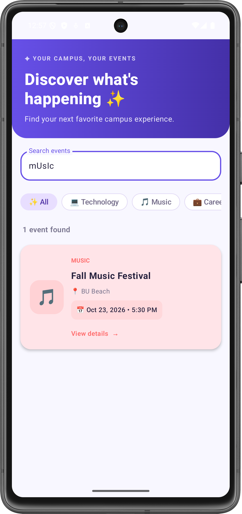

### 11. Combined Search and Category Filtering

**Test Case:** Apply search and category filters simultaneously.

**Input:** Search `Music` and select the Technology category.

**Expected Result:** No events appear because no event matches
both the search query and selected category.

**Observed Result:** The Technology chip remained selected,
the search field retained `Music`, and the app displayed
0 events found with an empty-state message.

### 12. Clearing Search Restores Events

**Test Case:** Clear an existing search query.

**Action:** Search for `Music`, then clear the search field
while the All category is selected.

**Expected Result:** All 8 campus events reappear.

**Observed Result:** Clearing the search query restored all
8 campus events, with the All category remaining selected.

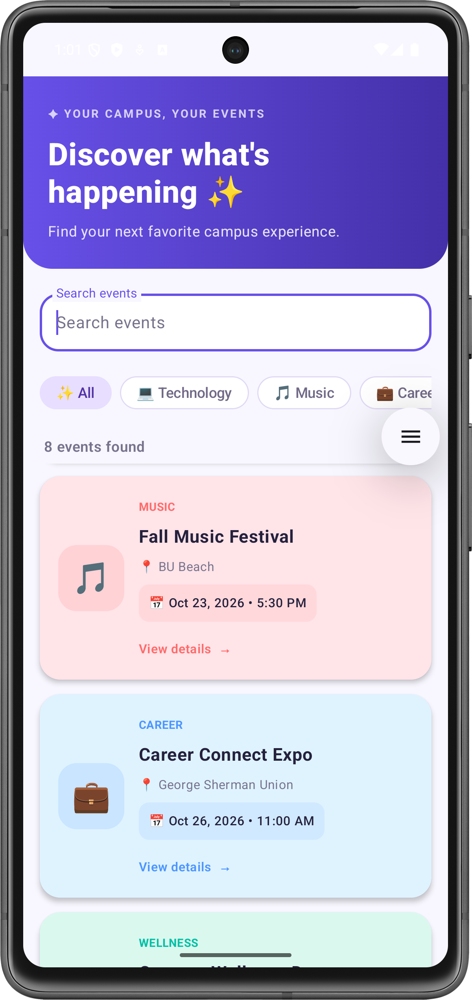

### 13. Category Selection After Rotation

**Test Case:** Preserve the selected category during device rotation.

**Action:** Select Music, then rotate the emulator to landscape.

**Expected Result:** The Music category remains selected,
and the filtered event list is preserved.

**Observed Result:** After rotation, the Music chip remained
selected, and Fall Music Festival was still displayed
with 1 event found.

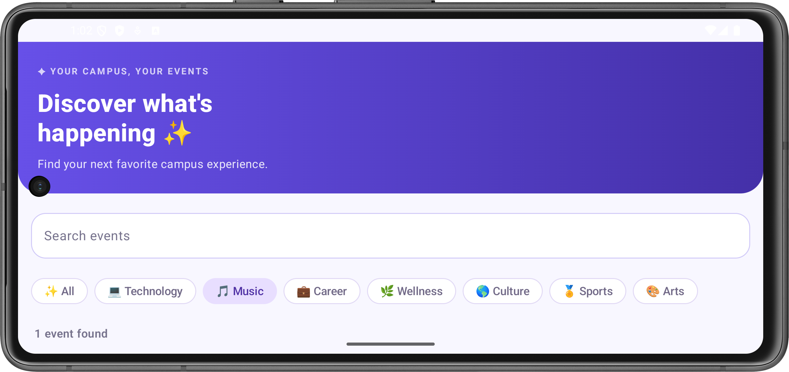

### 14. Event Details After Rotation

**Test Case:** Preserve the event details screen during rotation.

**Action:** Open Fall Music Festival and rotate the emulator.

**Expected Result:** The same event details remain accessible
without navigating back or crashing.

**Observed Result:** After rotation, the Fall Music Festival
details screen remained open with the correct event information
and Share Event button.

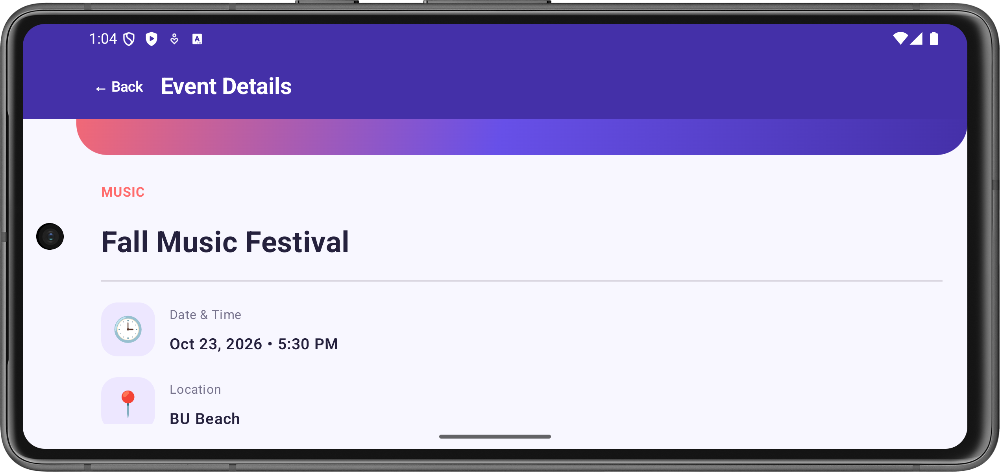

## Running the App

1. Clone the repository and open it in Android Studio.
2. Allow Gradle synchronization to finish.
3. Start an Android emulator (API 24+) or connect a device.
4. Select the `app` configuration and click **Run ▶**.
5. Browse, search, open, and share campus events.

## Architecture and State

The project separates `model`, `data`, `navigation`, `ui/screens`, `ui/components`, and `util`. An `EventRepository` interface abstracts event retrieval. Screens receive data and callbacks rather than directly controlling navigation. Navigation passes only the event ID, and the destination retrieves the corresponding event from the repository.

Search results are derived from the current query instead of being stored as duplicate mutable state.

## Testing and Results

### Manual Test Cases

The following test cases cover the main functionality and navigation behavior of Campus Event Explorer.

| Test Case | Expected Result |
|---|---|
| Launch application | Displays all 8 campus events |
| Search by event title | Displays events matching the entered title |
| Search by category | Displays events belonging to the searched category |
| Case-insensitive search | Matches events regardless of uppercase or lowercase input |
| Search with no matches | Displays an appropriate empty-state message |
| Clear search input | Restores the complete event list |
| Select an event | Opens the corresponding event detail screen |
| View event details | Displays title, category, location, time, and description |
| Navigate back | Returns to the event list |
| Preserve search after navigation | Retains the previous search query when returning from details |
| Rotate the device | Preserves the search query and keeps the interface usable |
| Share an event | Opens the Android Sharesheet with the event title, time, and location |
| Open an unknown event ID | Displays a fallback message without crashing |
| Scroll through events | Allows access to all events using the scrollable list |

### Test Environment

- **Device:** Pixel 7 Android Emulator
- **Language:** Kotlin
- **UI Framework:** Jetpack Compose and Material 3
- **Navigation:** Navigation Compose with type-safe routes
- **Minimum SDK:** API 24

### Screenshots

Screenshots of the application demonstrate the following scenarios:

1. **Event List:** All campus events displayed in the scrollable list.
2. **Search by Title:** Filtered events matching a title.
3. **Search by Category:** Filtered events matching a category.
4. **No Results:** Empty-state message for an unmatched query.
5. **Event Details:** Complete information for a selected event.
6. **Share Event:** Android Sharesheet displaying event information.
7. **Screen Rotation:** Search state retained in landscape orientation.

Screenshots will be added after capturing them from the emulator.
## AI Use

ChatGPT by OpenAI assisted with project structure, reusable component design, and README preparation. Generated suggestions are reviewed against the assignment requirements; application testing is documented separately.